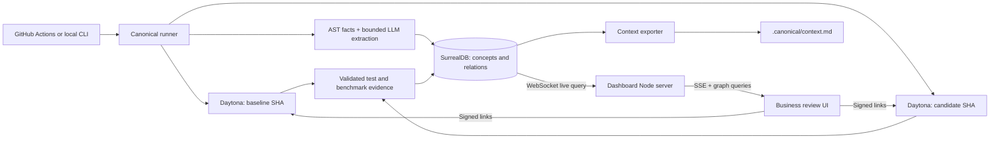

# Canonical: vertical-slice build plan

Based on [README.md](README.md), with platform and library research checked on October 16, 2026. Detailed sources and alternatives are in [RESEARCH.md](RESEARCH.md).

This is the product roadmap. The runnable app includes the declared-fixture v0 and exact Git comparison through Daytona, with CI artifact export and dashboard report import. Inference and live browser delivery remain later slices. See [the real CI guide](docs/REAL_CI.md) for the implemented path.

**Build a business-level commit review with executable evidence.** The demo should show an optimization that makes price quotes faster while accidentally giving one customer another customer's price. Canonical makes that tradeoff visible, reproduces the failure in Daytona, and exports the business context for the next coding agent.

The strongest pitch: **“Your coding agent made it faster. Did it still build the business you intended?”**

## The demo we should build

Use a tiny TypeScript quote service in `examples/quote-shop`, with a simple browser page. Keep its entire business implementation to roughly 6–10 source files. Analyze all of that service, while explicitly showing the selected repository subdirectory as the analysis scope.

Create two real commits:

1. **Baseline:** prices are fetched for the requesting account and SKU.
2. **Optimization:** add a cache keyed only by SKU. Once a wholesale customer requests a quote, a retail customer receives the cached wholesale price.

Prepare a third, corrected commit only if the core loop is complete. Its cache key includes all pricing inputs used by this fixture, including account and SKU. This is a prepared fix, unless an agent actually produces it during the demo.

Use these explicit fixture facts:

- Wholesale account Alpha pays $80 for the demo product.
- Retail account Beta pays $100 for that product.
- An approved requirement says a quote must use the requesting account's price.
- A local stub represents the upstream pricing service, with a documented fixed 15 ms delay. Both revisions use exactly the same stub. Timing is a real measurement of this synthetic workload; it is not a production performance claim.
- A repeat-quote benchmark makes the caching benefit visible. A separate cross-account test reveals the bug.

The dashboard should tell a nontechnical person: **“Repeat quotes got faster. Retail customers can now receive wholesale prices. One required business check failed.”** Substitute actual measured timing into the report. Do not invent an improvement percentage in advance.

This scenario avoids external payments, complex authentication, and nondeterministic inventory races. It connects performance, business meaning, executable checks, and a comprehensible graph in one story.

## Demo narrative

1. Show the baseline business map: Account → Price policy → Quote → Order.
2. Select the optimization commit and start analysis.
3. Show the before/after Daytona runs and incoming results.
4. Present the measured speed improvement beside the failed pricing requirement.
5. Click Quote to inspect the actual before/after behavior and evidence.
6. Export the business context and open it in the repo.

The memorable interaction is clicking a business concept and seeing the software violate its requirement. Historical results should identify their original revision and run.

## Scope and cut order

| Priority | Deliverable | Definition of done |
|---|---|---|
| P0 | Exact before/after revisions | Both sandbox checkouts verify their full SHA; report records both. |
| P0 | Business graph and semantic diff | 6–10 concepts, stable identities, source links, changed concepts highlighted. |
| P0 | Real Daytona execution | Same harness runs business checks and a benchmark against both revisions. |
| P0 | SurrealDB graph and live results | Persist native relations; traverse them for the evidence drawer; display new results live. |
| P0 | Observable failure | Separate signed preview links to before/after apps, plus structured failing test evidence. |
| P0 | Agent context feedback | Export a concise context file into the local demo repo with source SHA and rule provenance. |
| P0 | Minimal CI invocation | A workflow invokes the same runner for the owned demo branch and records its run ID. |
| P1 | Automated browser evidence | One Playwright scenario captures before/after screenshots. |
| P1 | Semantic question | One question, “Could this give a customer the wrong price?”, retrieves graph-backed evidence. |
| P2 | Prepared fix comparison | Third revision passes the same checks and retains the measured speed benefit. |
| Later | Arbitrary repos, full GitHub App, autonomous repairs, MCP server, multiple languages | Product roadmap, outside this build. |

Cut P2 first, then P1. Preserve the graph diff, execution, and evidence chain. Use fixed graph positions and manual preview interaction for the first slice; keep the underlying results real.

## Architecture

Default to TypeScript throughout, React + Vite for the UI, a small Node server for dashboard data, and a Node CLI for analysis. Use the stack either builder already knows if it avoids setup work.



Keep SurrealDB outside the disposable test sandboxes. Use one sponsor Cloud instance if provisioned; otherwise use one persistent local server for the local demo. Cloud is necessary for the simplest hosted Actions runner to reach the same database. The dashboard can run on a laptop; deploying it is optional.

Run the orchestrator directly inside GitHub Actions when using CI. This avoids building a webhook receiver, public job API, queue service, or GitHub App. The local CLI is also the recovery path if the hosted runner is delayed.

Only the runner and dashboard server hold database credentials. The test sandboxes need neither database nor LLM keys. They return bounded JSON and artifacts through Daytona. A one-run-at-a-time runner is sufficient.

Workspace structure:

```text
apps/ui/                    UI owner's React workspace
apps/api/                   Backend routes, configuration, storage selection
packages/contracts/         Shared Zod schemas and TypeScript types
packages/demo/              Declared business graph and UI fixture
packages/runner/            Evaluation pipeline and context export
integrations/daytona.ts     Daytona SDK calls
integrations/surrealdb.ts   SurrealDB connection, persistence, graph queries
integrations/schema.surql   Database schema
examples/quote-shop/        Executable pricing fixture
checks/                     Trusted business checks and benchmark harness
scripts/                    CLI entry points and integration smoke checks
```

Avoid a monorepo framework: a few npm workspaces or a single package with directories are enough.

## How business meaning is extracted

Separate **business intent**, **observed implementation**, and **execution evidence**. The candidate commit is allowed to change implementation; it must not silently redefine what counts as correct.

1. Put the approved glossary and three requirements in `.canonical/business.json`. These are explicit product inputs, not claimed AI discoveries.
2. Parse the small TypeScript service using `ts-morph`: exported functions, parameters, imports, call sites, source ranges, and changed lines. Limit support to ordinary functions and statically resolvable calls.
3. Give one bounded LLM request the glossary, extracted facts, relevant source, and Git diff. Request structured mappings to business concepts and a short behavioral explanation. Use another bounded request for baseline onboarding if needed.
4. Validate the output with Zod. Require every code claim to reference an existing file, symbol, and in-bounds source range. A valid citation establishes location, not semantic correctness; preserve the “inferred” label until execution supports the claim.
5. Keep approved business keys stable: `account`, `price_policy`, `quote`, `order`, `product`, `price_cache`. Compare normalized properties and relationships, rather than freeform prose or random model IDs.
6. Propagate changed symbols to their mapped concepts. Use graph traversal to identify potentially affected neighbors. “Potentially affected” is distinct from “test failed.”
7. Attach deterministic test results to the requirement and affected concepts. A failed test overrides optimistic narrative.

For this demo, `Quote` remains the same concept in both revisions; the change is the implementation of account-scoped pricing and the new cache dependency. The requirement “price belongs to requesting account” remains visible even when its implementation fails. Never delete the requirement edge merely because the code stopped satisfying it.

Show three evidence labels: **approved requirement**, **code inference**, and **executed check**. Explain observable behavior; do not claim access to the coding agent's private reasoning. A pass means the specified checks passed, not proof of all possible inputs.

Fallback if extraction fails: retain the approved business map and mark directly touched, explicitly mapped concepts. Display “semantic analysis unavailable”; use the genuine test results. A cached extraction must be labeled with its original SHA and extraction version.

## SurrealDB model and essential queries

Use a small application-versioned graph. The initial record tables are:

| Table | Essential data |
|---|---|
| `run` | Repo, analysis path, base/head SHA, stage, sequence, config/harness hash, timestamps, sandbox IDs |
| `concept` | Snapshot key, stable business key, label, observed description, provenance |
| `symbol` | Snapshot key, stable symbol key, file, range, content hash |
| `requirement` | Policy version, approved text, deterministic check ID, severity |
| `evidence` | Run, side, check ID, status, expected/actual, timing samples, artifact references |

Native relation tables:

- `symbol -> implements -> concept`
- `concept -> depends_on -> concept`
- `requirement -> constrains -> concept`
- `evidence -> validates -> requirement`

Each revision's concept and symbol records have different physical record IDs, with stable logical keys for comparison. A snapshot key combines repository, SHA, and analysis configuration hash. Scope edges to the same snapshot, including source evidence. Requirements can constrain each revision's concept records without being rewritten by the candidate.

Persist extraction in a transaction, then mark that snapshot ready. Compare the baseline/head snapshots in application code. This is enough to support history without relying on database storage time-travel features.

Illustrative SurrealQL, to smoke-test against the pinned server during implementation:

```surql
-- Assumes snapshot-scoped records and relations have already been created.
-- This reverse traversal finds rules attached to a specific Quote revision.
SELECT VALUE <-constrains<-requirement FROM concept:head_quote;

-- Retrieve that revision's implementation evidence.
SELECT VALUE <-implements<-symbol FROM concept:head_quote;

-- Then parameterize the selected run and rule in application queries.
SELECT * FROM evidence
WHERE run = $run_id AND requirement = $requirement_id;

-- Subscribe on the backend; forward validated events to the UI.
LIVE SELECT * FROM evidence WHERE run = $run_id;
```

The redundant requirement record link on `evidence` is deliberate: it simplifies filtering while native relations support the explanation path. Use bound parameters, not model-generated query strings. Every query must be scoped to the selected run/revision.

For live updates, subscribe to `run` and `evidence`, then refresh affected graph data. Start the subscription before fetching the initial state; reconcile by record ID and sequence. After reconnect, resubscribe as necessary and fetch authoritative state again. Live notifications are a UI signal, not a durable job queue. See [live-query constraints](RESEARCH.md#surrealdb-live-updates).

## Daytona execution and fair comparison

Create two same-sized sandboxes from the same runtime image/snapshot, in the same region. Check out the two exact revisions, verify them, install locked dependencies, and run the same trusted harness. Prepare the runner image early; a default image is acceptable if snapshot preparation delays the critical path.

The trusted harness comes from the analysis configuration, not a candidate's rewritten test expectations. Store its hash and the approved policy hash. Future PRs that change policy or harness should surface that as a separate review event.

Run these business checks:

| Check | Fixture | Expected result |
|---|---|---|
| Account-scoped price | Alpha requests SKU, then Beta requests the same SKU without clearing cache | Alpha $80; Beta $100 |
| Repeat consistency | Same account requests the same SKU twice | Same valid price both times |
| Invalid quantity | Request zero or negative quantity | Rejected according to the approved fixture contract |

Use a fresh service process or explicit reset between independent checks. Preserve state between Alpha and Beta within the cross-account test. Check both request orders if inexpensive. Store expected and actual values, not just exit codes.

Benchmark a clearly named workload: **warm repeat-quote service latency**. Use identical account/SKU inputs, request counts, concurrency, warmup, and the same mocked upstream. Suggested budget: 10 warmup requests and three batches of 100 sequential measured requests per revision; store raw durations, per-batch median, p95, and failure counts. Run timing stages sequentially, alternating revision order across batches, while avoiding other work inside those sandboxes. Use an internal timer around the service request path; exclude provisioning and package installation.

Also show an upstream lookup counter. It helps explain the mechanism even if wall-clock timing is noisy. Do not count incorrect responses as valid throughput: display latency and correctness together. If measurements are unstable, say “inconclusive” and retain the verified business failure. A hard latency budget can be a fixture requirement, but a small relative change should not determine pass/fail by itself.

Start a long-running app session in each sandbox and expose the app port with an expiring signed preview URL. Prefer a new tab first; iframe embedding is optional. Refresh links immediately before presenting. Preserve JSON evidence before cleanup, and keep the demo sandboxes alive only for the preview window. See [Daytona preview details](RESEARCH.md#daytona-preview-and-evidence).

## UI that makes the result obvious

Use one screen with a deliberate reading order:

1. **Commit verdict:** “Review required: account pricing failed.” Include base/head short SHAs and analysis scope.
2. **Three cards:** business checks, measured repeat-quote latency, affected concepts. Pending and unavailable states must be explicit.
3. **Business map:** 6–10 legible nodes. Gray unchanged, amber changed/inferred impact, red executed failure, green added. Include icons/text so color is not the only signal.
4. **Evidence drawer:** clicking Quote shows the business rule, actual before/after values, source location, sandbox metadata, and preview buttons.
5. **Context export:** a visible button with a preview of the generated content.

Use React Flow with fixed initial positions; retain those positions across revisions. Animate only the path involved in the selected change. Added/removed relationships should be visible without making the graph rearrange. Keep low-level symbols in the drawer.

The optional question box should answer only from the selected run's evidence. A curated question chip plus graph traversal can be useful even before embeddings exist. If vector retrieval is added, label and implement it honestly; a preset question is not semantic search.

## Context feedback

Implement a local export command that queries the selected run and writes `.canonical/context.md` into an explicitly chosen demo checkout. The dashboard can preview and download the same content. Include:

- Approved business glossary and requirements.
- Relevant concepts and source locations.
- Last analyzed base/head SHA and policy/harness versions.
- Passing/failing checks and reproduction commands.
- A concise warning that account-specific prices must not share a cache entry.
- “Generated from run …; refresh after code changes.”

Point the repository's agent instructions at that file during implementation. No new MCP server is necessary. Exporting a failed candidate's report must preserve the approved requirements and identify the candidate as failing; it must not replace product intent with the bug.

Do not automatically commit generated files on each analysis run. A local export and an artifact from CI demonstrate the feedback loop without recursive workflow commits.

## Vertical slices and ownership

The backend owner works in `apps/api`, `packages/runner`, and `integrations`. The UI owner works in `apps/ui`. Agree changes to `packages/contracts` together; it is the handoff boundary. The UI can run independently against the shared fixture while the backend grows.

| Slice | Backend | UI | Acceptance boundary |
|---|---|---|---|
| v0: runnable fixture | Execute trusted local checks, expose runs, export context | Start a run, render graph and evidence, download context | One working end-to-end loop without credentials; fixture origin is explicit |
| v0.1: sponsor execution and persistence | Run the same fixture in Daytona; persist graph in SurrealDB | Consume the unchanged run contract and display execution provenance | Same scenario passes through real sponsor services |
| v1: actual commit comparison | Fetch exact Git revisions; trusted harness; source metadata | Revision selector, real changes, source links | Every result is attached to its verified revision |
| v2: inferred business map | Parse source and validate structured model mappings | Distinguish declared intent, inference, and executed checks | Graph reflects source-backed behavior rather than the fixed demo glossary |
| v3: continuous review | CI invocation, live database events, recovery, run history | Live progress and history; robust reconnect and error states | A commit produces a reviewable, persistent report |
| Extensions | Browser evidence, grounded retrieval, prepared fix comparison | Browser replay, question flow, comparison views | Each addition strengthens the same review loop |

Ship and inspect each slice before expanding it. The v0 fixture does not claim Git comparison, AI extraction, or production benchmarking. Preserve that distinction in the UI and API.

## CI details and completion checks

Use `push` on the owned demo branch, with a path filter for the demo service, plus `workflow_dispatch` for rehearsal. Pass base/head full SHAs explicitly. For a later `pull_request` trigger, use the event's head SHA rather than assuming `GITHUB_SHA` is the branch tip; GitHub documents that it can identify the PR merge commit. [GitHub workflow events](https://docs.github.com/en/actions/reference/workflows-and-actions/events-that-trigger-workflows#pull_request)

Use a unique run ID and a logical cache key containing repo, base/head SHA, harness hash, policy hash, and analyzer version. Retried delivery should not duplicate evidence; explicit reruns can have a fresh attempt ID. Save the report before returning a failed CI exit status for business-check failure. Setup/runtime failures get a separate error status.

Before calling the demo complete, verify:

- The bad commit fails the cross-account check; the baseline passes it.
- The same revision compared with itself produces no semantic diff.
- A failed or timed-out check never becomes green or disappears from the denominator.
- Source links and sandbox SHAs match the selected revision.
- Restarting/refetching the dashboard recovers the saved report.
- New evidence arrives through SurrealDB live queries; reconnect recovers current state.
- Preview URLs work in a normal browser without exposing the sandbox-wide token.
- The exported context contains the approved rule and the actual failing evidence.
- The recorded fallback includes real run IDs, SHAs, and timestamps.

These are focused integration checks, not a separate testing project.

## Practical constraints

Analyze an owned demo repository/branch during the hackathon. Clone and run candidate code only inside Daytona; keep control-plane secrets outside it. Bound execution time, model output size, and artifact size. These choices directly support the commit-running feature.

Keep a maximum of two active evaluation sandboxes, plus an optional temporary fix sandbox. Check sponsor quota early; configure cleanup and verify it after rehearsals. Dollar cost depends on the supplied credits, resources, and runtime—do not assume a free tier or promise a fixed cost.

The database stores report metadata and small structured evidence. For optional screenshots, a bounded small attachment is acceptable for this demo; download full traces to runner artifacts before sandbox deletion. Expiring sandbox links are not permanent evidence storage.

The product boundary is explicit: this prototype analyzes one small TypeScript service with a declared glossary and executable business requirements. General ontology discovery, trustworthy arbitrary-repo test generation, and production performance prediction remain future work.
